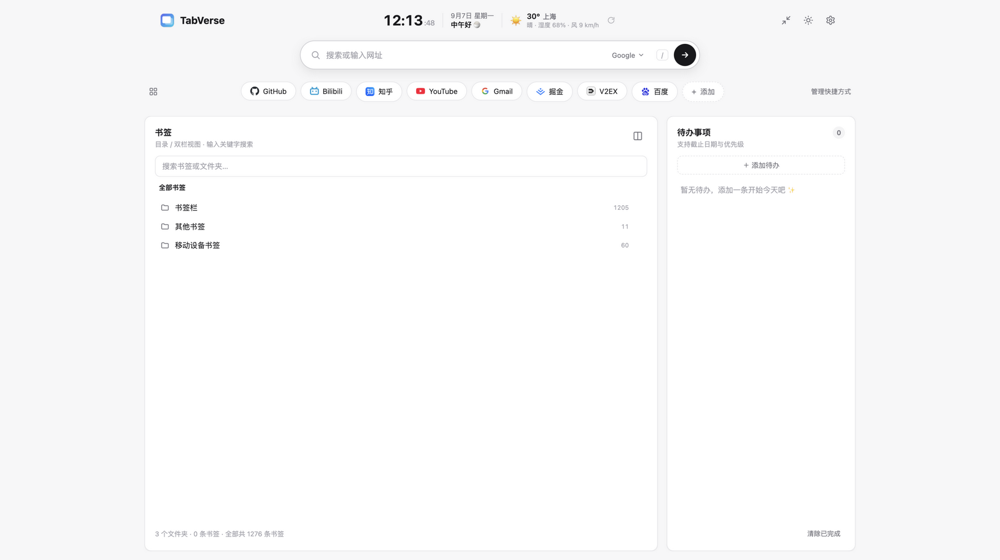
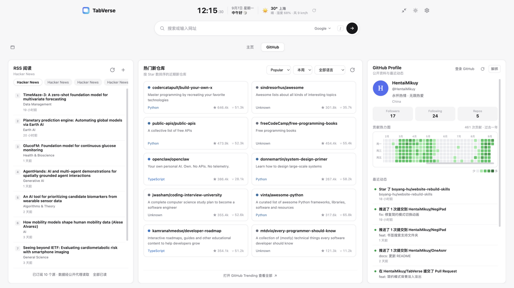

# TabVerse

[中文](./README.md)

A Chrome new tab info dashboard

A browser extension that makes Chrome's new tab page more useful and more aggregated.

By default, the new tab page only has a search box and a background image. TabVerse turns it into a minimal-style info dashboard (card layout, design language inspired by [XTab](https://github.com/pkc918/XTab)):

| Feature | Description |
|------|------|
| 🔍 Aggregated search | Google / Bing / Baidu / DuckDuckGo / GitHub engine switcher (default configurable in settings); opens URLs directly; shows search suggestions while typing (arrow keys to select); press `/` to focus |
| 🔗 Shortcuts | Pill-shaped favorite sites; in "Manage" mode you can add / edit / delete and drag to reorder; site icons are fetched automatically, falling back to letter avatars |
| 🔖 Browser bookmarks | Browse folders level by level (breadcrumb navigation); split view supports "Default order / Recently added"; global keyword search matches both bookmarks and folders — a matched folder appears as its own result row (with bookmark count; click to enter that folder directly) |
| ✅ To-dos | Add / complete / edit / delete / clear all done; due dates and priority (overdue hint; dates outside this year show days left, hover for the full date); saved locally |
| 🌤️ Weather | Free open-source Open-Meteo data, automatic IP geolocation |
| 📰 RSS feeds | Add / remove / reorder feeds; clicking a title marks it read; "Mark all read"; read state saved locally |
| 🐙 GitHub panel | Discover trending / new repos and Profile contribution graph; optional OAuth login raises the API quota from 60/hour to 5000/hour |
| 🗂️ Tab framework | Modules organized by tabs; toggle "Shortcuts ⇄ Tabs" from the sub-bar |
| 🕐 Clock & greeting | Real-time clock, date and time-of-day greeting (timezone selectable in settings) |
| ☀️ Light / dark | Toggle from the top-right icon |
| 🌐 Multi-language | Simplified Chinese / English, follows browser language by default (Settings → Language) |
| 🧘 Minimal mode | One click hides all panels, leaving only time, date and the search box — a truly minimal new tab |
| 🖼️ Custom background | Image / video background in minimal mode (local file or URL), adjustable scrim for text readability |

Data is stored only in Chrome's extension storage — nothing is ever sent to a self-hosted or third-party server. The two storage areas have distinct jobs:

- **Cross-device sync (`chrome.storage.sync`) holds user data only**: settings, to-dos, shortcuts and RSS feed URLs. With Chrome sync enabled these roam across the account's devices; otherwise they stay local.
- **Everything else stays on the device (`chrome.storage.local`)**: weather / RSS article / GitHub caches, device state (active tab, view preferences), the GitHub token, custom backgrounds and site icons. Caches are per-device by nature — a new device just refetches or logs in again — so they never consume the sync quota (8 KB per item / 100 KB total / 120 writes per minute).

Settings → Export / Import covers exactly that user data, and caches or device state left in `sync` by older versions are migrated to `local` automatically after an upgrade.

## Tech stack

**WXT + Vue 3 + TypeScript**

- [WXT](https://wxt.dev/)
- Vue 3 + Composition API
- TypeScript (zero type errors)

## Installation

1. Run `pnpm build`
2. Open Chrome and go to `chrome://extensions`
3. Enable Developer mode → Load unpacked → select `.output/chrome-mv3/`
4. Open a new tab to try it out

## Changelog

- **v0.6.2** (current): to-do due dates are now labelled by distance from today — today / tomorrow / the day after use relative wording; next-year dates no longer show only month and day (which reads as this year) and show "N days left" instead; dates more than a year away, and overdue items from previous years, show the full date with the year, and hovering reveals the exact date; day math is UTC-normalized to avoid timezone and DST drift. Storage layout rework: `chrome.storage.sync` now holds user data only (settings, to-dos, shortcuts, RSS feed URLs) while caches and device state moved to `chrome.storage.local`, with a one-time automatic migration on startup that frees sync quota (8 KB per item / 100 KB total / 120 writes per minute)
- **v0.6.1**: fixes quick links / to-dos / RSS feed edits not persisting across reloads — passing Vue reactive (Proxy) arrays to `chrome.storage` serializes them as plain objects instead of arrays, so the shape check failed after a reload and default data was restored (edits appeared to "revert"); writes are now normalized to plain data before storing, and readers recover legacy object-shaped entries automatically
- **v0.6.0**: bookmark search now matches folders — a folder whose title matches is shown as its own result row (with bookmark count and an enter button; clicking enters the folder and clears the query) instead of expanding the whole subtree; bookmarks / subfolders that match individually are still listed one by one with folders first, and empty folders or folders containing only matching subfolders no longer trigger a false "not found"; smoother transitions between normal and minimal mode (crossfade with a slight scale/shift, no stutter when switching back, and a new tab in minimal mode no longer flashes the normal view); the custom background layer now fades in/out and pauses video when hidden
- **v0.5.0**: adds minimal mode (only time, date and search box; toggle in/out from the top-right) and custom background (shown only in minimal mode; image / video, local file or URL, adjustable scrim; video auto-pauses when hidden); UI i18n (Simplified Chinese / English, selectable in settings, follows browser language by default) — clock date, weather, GitHub activity and more switch with the language; settings drawer adds a theme segmented control, language, timezone and default search engine selection, and the data management buttons are redesigned as icon-bordered buttons that adapt to the theme; the search bar uses a frosted-glass semi-transparent style in minimal mode
- **v0.4.0**: feed removal (hover ✕ on chip), Google Research switched to the official RSS feed with automatic migration; GitHub data 30-minute local cache + rate-limit state persistence — within the rate-limit window the new tab shows a countdown instead of firing invalid requests, with auto-retry after reset; bookmark split view (folder tree on the left + bookmarks on the right, toggled from the top-right icon, search works across views) with "Default order / Recently added" sorting; two-level site icon caching (memory + `chrome.storage.local`, deduped, capacity-capped); DuckDuckGo suggestion while typing (arrow-key selection, prefix cache); shortcut drag reorder and click-to-edit; to-dos with due dates and priority (overdue hint); RSS title click marks read, "Mark all read", read state persisted locally; optional GitHub OAuth login (Device Flow, token stored locally, quota 60/hour → 5000/hour); settings export / import; fixes for negative relative time, sub-bar and content column width misalignment, and more
- **v0.3.0**: initial release. WXT + Vue 3 + TypeScript from scratch: aggregated search, shortcuts, weather, to-dos, bookmark breadcrumb folder browsing, tab framework (Shortcuts ⇄ Tabs), RSS reader and GitHub Discover / Profile panels, light/dark theme

### Roadmap

- Interaction polish and performance optimization

## Privacy

- No data collection
- Weather, icons and suggestions use free public APIs
- Only three API permissions are declared: `storage`, `bookmarks`, `unlimitedStorage`; a wildcard host permission (`*://*/*`) is also declared so RSS feeds and site icons can be fetched directly (bypassing CORS) — it is only used when requesting the corresponding sites
